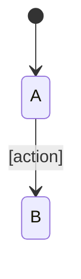

# Spec template

Assemble the reviewable document with this structure. Sections 1 and 2 come from the interview and section 8 is fixed text; everything else is generated from the model and the checker's report.

````markdown
# [Feature Name]

> **Status:** Draft, for review · **Locked:** [rules, copy, design, or none] · **Owner:** [Name] · **Date:** [YYYY-MM-DD]

**How to review (about 15 minutes):** 1. Is section 1 the right problem? 2. Ask an agent to run the review quiz on section 4. Without an agent, write down what you expect for each example, then check it against the answers at the end of the section. 3. Answer every open decision in section 6, and check *My calls*. 4. Leave the notes in section 8 as a review comment.

## 1. Problem and goal

[The problem, the persona, and why now. This is the only free prose in the spec.]

| Success measure | Today | Target |
|---|---|---|
| [Observable measure] | [Baseline, or NEEDS CLARIFICATION] | [Target] |

## 2. Scope

**In:** […]
**Out:** […]
**Must not change:** [Existing behaviour this change touches and must preserve]
**Anti-goals:** [What would make this a failure even if it works. Each one is an invariant in section 3.]
**Principles:** [The defaults H1–H10 and A1–A3 apply, except: [any the operator set aside, and why]. This feature's own: P1, P2…, in the operator's words.]
**Left to the builder:** [What this spec deliberately does not decide]

## 3. Rules

[Invariants, one sentence each.]

<!-- One section per area of the journey, in the order people act. -->

### [Area: one step of the journey]

| | When… | Then |
|---|---|---|
| UP1 | [actor] [does] | [outcome], because [reason, only when it is not obvious] |

#### Edge cases

| | When… | Then |
|---|---|---|
| UP7 | [actor] [does] | [outcome] |

### What exists today

<!-- Only when the feature touches existing behaviour. Product words only: the evidence is in baseline.md. -->

| | Behaviour | Status |
|---|---|---|
| B1 | [what the product does today, in product words] | Verified · or · Unverified: test pending |

<!-- Only for the dimensions this change affects; omit the table otherwise -->

| Non-functional | Threshold |
|---|---|
| [performance, security, accessibility…] | [number, or NEEDS CLARIFICATION] |

## 4. Examples

<!-- One table per area. Every outcome comes from a model run, written as the rules below say. -->

| | Situation | What happens |
|---|---|---|
| E1 | [one or two sentences: only what the example needs] | [the action, in words] |

### Answers

<!-- After every area's table, so a reader predicts before they reach them. -->

- **E1 (R1).** [what changes, for whom]

## 5. Lifecycle

<!-- Include only when an entity moves between states. Generate it from the model. -->



## 6. Decisions

### Open

#### Q1 · [Short name]

1. [Step, in product words]
2. [Step]
3. [Step]

What should happen?
- (a) […]
- (b) […]
- (c) Something else

### Proposals

<!-- After every open question, so a reader answers before they reach them. -->

- **Q1.** (b), because […]

### Decided

<!-- Only rejected alternatives, and decisions no rule states. The full log is in the state file. -->

| | Decision | By | Why |
|---|---|---|---|
| D1 | [decision, or the alternative rejected] | [operator or designer] | [one-line reason] |

### My calls

<!-- Decided by the agent because a sensible builder would choose the same way. The operator can veto any of them. -->

| | Call | Why |
|---|---|---|
| C1 | [call] | [one-line reason] |

## 7. How this spec was checked

[Two sentences: what the checker tried, in people and steps, and what it found.]
**Not covered:** [what the model leaves out, and what covers it instead].
Model: [path] · Checker: [path] · Report: [path] · Scenarios: [path]

<!-- State counts, bounds per run and which checks held go in the report, not here. -->

## 8. Before you approve

Ask an agent to run the review quiz on this spec. If you read without an agent, leave these as a review comment:
1. Where your prediction differed from an outcome in section 4, and which rule you'd change.
2. Which open decisions or calls you'd decide differently from the proposal.
3. Anything missing that you'd expect in a spec.
````

## Writing the examples

The model's states are for the checker; the examples are for a person who predicts the outcome. Render each one as a change, never as a state dump:

- **Situation:** one or two sentences with only the people, rules and attempts the example needs. Leave out everyone it does not touch.
- **What happens:** the action in words. Several steps become one sentence each, in order.
- **Outcome:** only what changes, and for whom: what they see, what is refused and why, what they are asked to confirm. Leave out steps that do nothing.
- **Names:** realistic product names ("Anna", "Front Desk", "Upselling"), never model identifiers (`ana`, `FD`, `c1`, `mgrA`). The spec needs no legend.
- **Conditions:** as a reader says them ("assigned to Front Desk"), never as notation (`Department ∈ {FD}`).
- **Rule IDs** go with the answer, not in the table, so the cited rule does not give the outcome away.
- **Plain Markdown only.** No HTML such as `<details>`: many viewers show it as raw text, which gives every answer away.

What each actor sees after each step stays in the scenarios file, for the engineers and the tests.

```markdown
| | Situation | What happens |
|---|---|---|
| E7 | Upselling is assigned to Front Desk. Anna, in Front Desk, is halfway through it. | An admin moves Anna to Housekeeping. |

### Answers

- **E7 (R3, D4).** The admin is asked to confirm that 1 course in progress will be interrupted. On confirm, Anna's attempt is interrupted and Upselling leaves her *Assigned to you*.
```

An example open decision, as the operator should see it:

```markdown
#### Q1 · Undo after another editor's change

1. Editor A renames the item to "Draft".
2. Editor B renames it to "Final".
3. Editor A clicks Undo.

What should the name be?
- (a) The original name. A's change is undone, and B's change is lost without notice.
- (b) "Final". Undo is refused, because the item changed after A's edit.
- (c) Something else
```

Its proposal goes under *Proposals*: `- **Q1.** (b). Undo must never discard someone else's work.`
